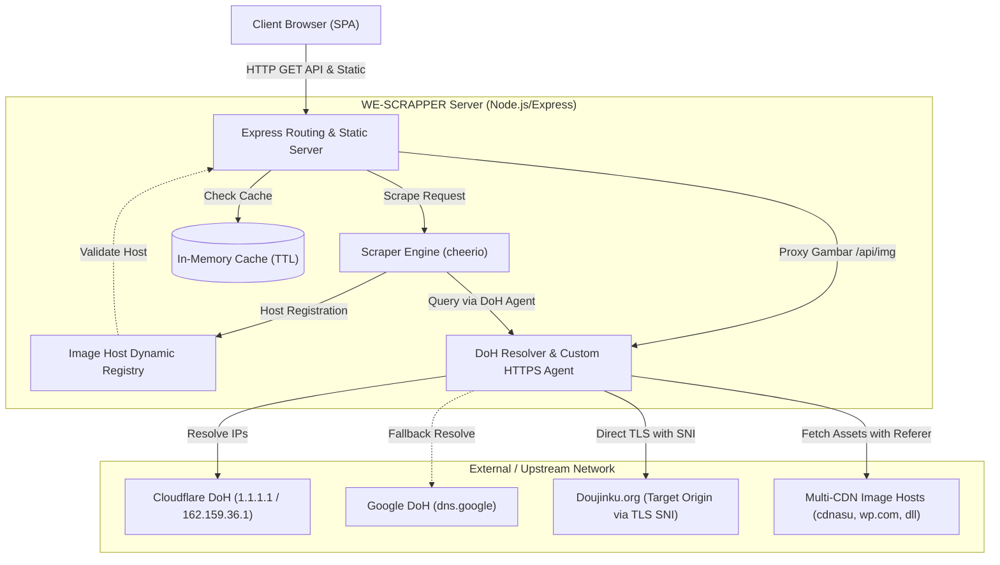

# Product Requirements Document (PRD): WE-SCRAPPER

---

## Document Control
- **Product Name:** WE-SCRAPPER
- **Version:** 1.1 (Production/Current) & Roadmap ke 1.2
- **Status:** Active / Maintained
- **Target Audience:** Internal Developer, Contributor, Self-Hosters
- **Last Updated:** Oktober 2026

---

## 1. Executive Summary & Product Vision

### 1.1 Ringkasan Produk
**WE-SCRAPPER** adalah aplikasi web *lightweight* (Node.js & Vanilla SPA) yang berfungsi sebagai crawler, parser, proxy aset, dan reader untuk membaca komik/manga dari situs sumber ([doujinku.org](https://doujinku.org/)). 

Aplikasi ini dirancang khusus untuk mengatasi kendala pemblokiran tingkat jaringan (DNS Hijacking oleh ISP Indonesia seperti Telkomsel / Internet Baik) dan proteksi anti-bot Cloudflare WAF tanpa mengharuskan pengguna akhir memasang VPN atau mengubah setelan DNS pada perangkat mereka.

### 1.2 Visi & Nilai Utama
1. **Zero-Configuration Access:** Pengguna dapat mengakses konten secara instan melalui browser lokal tanpa VPN, DoH client, atau ekstensi khusus.
2. **Clean & Distraction-Free:** Menghilangkan iklan pop-up, redirect judi online, dan script tracker invasif yang umum terdapat pada situs agregator manga.
3. **High Performance & Lightweight:** Arsitektur tanpa framework berat (Express + Vanilla JS), memanfaatkan DoH anycast direct-socket, in-memory caching cerdas, dan proxy gambar dengan dynamic whitelist.

---

## 2. Problem Statement & User Needs

### 2.1 Latar Belakang Masalah
1. **DNS Hijacking oleh ISP Nasional:**
   - Domain `doujinku.org` masuk dalam daftar blokir TrustPositif / Internet Baik.
   - Permintaan DNS standar diarahkan ke IP blokir (misal `202.3.218.139`), menghasilkan tampilan blokir alih-alih situs asli.
2. **Proteksi WAF & Cloudflare Challenge:**
   - Pencarian query standar `?s=<keyword>` pada situs target kerap dihadang Cloudflare Challenge / CAPTCHA (HTTP 403 / 503).
3. **Fragmentasi CDN & Masalah Mixed Content:**
   - Halaman manga menyajikan gambar dari berbagai domain CDN pihak ketiga (`cdnasu.xyz`, `cdngue.xyz`, `cdn.uqni.net`, `i*.wp.com`).
   - Sebagian CDN menyajikan gambar via protokol HTTP non-enkripsi atau memblokir request langsung tanpa header `Referer` yang sah.
4. **Data Delivery Dinamis:**
   - Daftar gambar chapter tidak tersedia langsung pada tag `` HTML statis, melainkan di-embed dalam script JavaScript runner `ts_reader.run({...})` dengan format pseudo-JSON (karakter boolean `!0` / `!1`).

### 2.2 Target Pengguna & Personas
- **Pembaca Manga Mandiri (End-User):** Pengguna di Indonesia yang ingin membaca konten komik dengan pengalaman yang cepat, responsif, hemat kuota, dan bersih dari iklan.
- **Self-Hoster / Enthusiast:** Pengguna yang menjalankan server pribadi di localhost, Docker, VPS, atau Raspberry Pi untuk kebutuhan konsumsi media keluarga/pribadi.

---

## 3. Goals & Non-Goals

### 3.1 Product Goals (In-Scope)
- **Bypass DNS Hijacking:** Resolusi alamat domain target menggunakan DNS-over-HTTPS (Cloudflare DoH IP statis) dengan direct TLS connection socket.
- **Clean Scraping API:** Menyediakan REST API internal untuk katalog manga, pencarian, detail serial, dan daftar gambar per chapter.
- **Image Proxying & Dynamic Whitelist:** Meneruskan gambar dari CDN asli dengan inject header referer, konversi mixed-content ke HTTPS, dan dynamic host registry.
- **Responsive Web Reader:** UI SPA (Single Page Application) modern dengan dark mode, navigasi chapter, pagination, dan lazy-loading gambar.
- **Chapter Download as PDF:** Kemampuan mengunduh seluruh halaman dalam satu chapter menjadi satu berkas dokumen PDF tunggal untuk pembacaan offline tanpa aplikasi reader khusus.
- **Cloudflare Rate-Limit Mitigation:** Mengimplementasikan in-memory caching berjenjang untuk mencegah IP server diblokir Cloudflare.

### 3.2 Non-Goals (Out-of-Scope saat ini)
- Tidak menyediakan penyimpanan permanen gambar/konten di disk/database lokal (produk murni bersifat live scraper & transient proxy).
- Tidak menyediakan sistem autentikasi user/login akun upstream doujinku.org.
- Tidak ditujukan untuk public commercial aggregator atau melanggar hak cipta penerbit asli.

---

## 4. Architecture & Technical Design

### 4.1 System Architecture Diagram



### 4.2 Tech Stack
| Lapisan | Teknologi | Keterangan |
|---|---|---|
| **Runtime** | Node.js (>= 18) | JavaScript runtime |
| **Framework Backend** | Express.js (v4.19.2) | Web server & REST API |
| **HTML Parser** | Cheerio (v1.0.0) | Parsing DOM sisi server yang cepat |
| **Network Core** | Native Node.js `https`, `tls`, `http` | Custom agent untuk DoH bypass |
| **Document/PDF Engine** | PDFKit / PDF-Lib *(v1.2 Target)* | Penyusunan halaman gambar menjadi dokumen PDF terstruktur |
| **Archiver** | Archiver (v8.0.0) | Utilitas kompresi arsip ZIP/CBZ (opsional) |
| **Frontend** | Vanilla JS (ES6+), CSS3, HTML5 | SPA berbasis hash navigation, no build-step |

---

## 5. Functional Requirements (FR)

### FR-01: Bypass DNS Hijacking & Custom TLS Socket
- **Deskripsi:** Sistem harus mampu meresolusi IP asli domain `doujinku.org` dan domain CDN terkait secara independen dari resolver DNS ISP lokal.
- **Mekanisme:**
  - Query DoH langsung dikirim ke IP Anycast statis Cloudflare (`1.1.1.1`, `162.159.36.1`) dengan header `Host: cloudflare-dns.com` dan fallback ke Google DoH JSON API.
  - Hasil resolusi DNS di-cache selama 5 menit (TTL).
  - Menginisialisasi `tls.connect` langsung ke IP target, namun menyematkan `servername` sesuai domain asli agar sertifikat SSL/TLS tetap valid (`rejectUnauthorized: true`).

### FR-02: Katalog Manga & Filter Urutan
- **Deskripsi:** Pengguna dapat melihat daftar katalog manga dengan dukungan pagination dan sorting.
- **Kriteria Penerimaan:**
  - Endpoint: `GET /api/latest?page=:page&order=:order`
  - Nilai order valid: `update` (terbaru), `popular` (terpopuler), `rating` (rating tertinggi).
  - Menampilkan thumbnail cover, judul komik, status rilis, tipe, rating, dan chapter terbaru.
  - Memiliki tombol navigasi *Sebelumnya* dan *Berikutnya*.

### FR-03: Pencarian Manga Anti-WAF
- **Deskripsi:** Pengguna dapat mencari manga berdasarkan kata kunci judul.
- **Kriteria Penerimaan:**
  - Endpoint: `GET /api/search?q=:query&page=:page`
  - Scraping memanfaatkan endpoint WordPress REST API internal (`/wp-json/wp/v2/search?search=:q&per_page=20&page=:page`), bukan query string HTML `?s=` untuk menghindari Cloudflare bot mitigation.
  - Mengembalikan daftar hasil pencarian yang relevan berserta slug untuk navigasi langsung ke detail manga.

### FR-04: Detail Manga & Indeks Chapter
- **Deskripsi:** Menampilkan informasi komprehensif serial manga.
- **Kriteria Penerimaan:**
  - Endpoint: `GET /api/manga/:slug`
  - Informasi yang disajikan: Judul lengkap, cover ukuran penuh, skor rating, total pengikut, daftar genre/tags, deskripsi/sinopsis, metadata rilis, dan seluruh daftar chapter terurut.
  - Dukungan normalisasi slug (unicode encoding/decoding seperti simbol `○`).

### FR-05: Chapter Reader & Page Extraction
- **Deskripsi:** Pengguna dapat membaca halaman gambar chapter secara berurutan (*long-strip vertical reader*).
- **Kriteria Penerimaan:**
  - Endpoint: `GET /api/chapter/:slug`
  - Parser mampu mengekstrak array URL gambar dari struktur script `ts_reader.run({...})` menggunakan algoritma *brace-balanced scanning*.
  - Menghandle ekspresi boolean terkompresi (`!0` menjadi `true`, `!1` menjadi `false`).
  - Menyediakan referensi `prevSlug` dan `nextSlug` untuk navigasi antar chapter.

### FR-06: Image Proxying & Dynamic Whitelist Security
- **Deskripsi:** Proxy lokal untuk meneruskan gambar manga agar terhindar dari mixed-content, blokir hotlinking CDN, dan ISP DNS blocking.
- **Kriteria Penerimaan:**
  - Endpoint: `GET /api/img?u=:encoded_url`
  - Keamanan host: Mencegah Open Proxy / SSRF dengan memvalidasi domain tujuan terhadap whitelist statis (`doujinku.org`, `*.wp.com`) dan *Dynamic Registry* yang didaftarkan secara otomatis saat proses scraping katalog/chapter berlangsung.
  - Mengirim header `Referer: https://doujinku.org/` dan `User-Agent` modern saat mengunduh dari CDN.
  - Menghasilkan response header `Cache-Control: public, max-age=86400` untuk utilisasi browser caching.

### FR-07: Health Check System
- **Deskripsi:** Verifikasi kesiapan koneksi server terhadap target origin dan DoH resolver.
- **Kriteria Penerimaan:**
  - Endpoint: `GET /api/health`
  - Mengembalikan status HTTP 200, daftar IP hasil resolusi DoH aktif, dan basis URL target.

---

## 6. Non-Functional Requirements (NFR)

### 6.1 Performance & Caching Strategy
- **In-Memory Cache Policy:**
  - Katalog Terbaru/Populer (`latest`): TTL **2 menit**.
  - Hasil Pencarian (`search`): TTL **3 menit**.
  - Detail Manga (`manga`): TTL **5 menit**.
  - Konten Chapter (`chapter`): TTL **10 menit**.
  - DNS DoH Resolution: TTL **5 menit**.
- **Lazy Loading:** Frontend wajib menerapkan `loading="lazy"` pada elemen `` untuk menghemat bandwidth klien dan memori server.

### 6.2 Security & Protection
- **SSRF Prevention:** Endpoint `/api/img` hanya mengizinkan protokol `http:` / `https:` dan domain yang terdaftar dalam dynamic registry.
- **Information Disclosure:** Server Express mematikan header `X-Powered-By` (`app.disable('x-powered-by')`).
- **Payload Limit:** Pengecekan ukuran buffer gambar maksimal di `fetchAsset` untuk menghindari memory exhaustion attack.

### 6.3 Reliability & Fault Tolerance
- **DoH Multi-Provider Fallback:** Jika Cloudflare DoH via IP statis mengalami gangguan jaringan, fallback otomatis dialihkan ke Google DoH JSON API.
- **HTTP Redirect Handling:** Handler koneksi menangani redirect internal 1 tingkat (301/302).
- **Graceful Error Handling:** Frontend menampilkan pesan error deskriptif (misal: "Gagal memuat manga", "Tidak ada hasil pencarian") tanpa crash aplikasi.

### 6.4 Usability & UI/UX
- **Hash-Route SPA:** Navigasi cepat tanpa reload halaman penuh (`window.addEventListener('hashchange', ...)`).
- **Dark Theme:** Palet warna gelap standar industri manga reader (latar belakang `#0e1217`, kartu `#171c26`, aksen ungu/indigo `#6366f1`).
- **Mobile First Responsive:** Grid thumbnail dan layout detail menyesuaikan ukuran layar ponsel, tablet, maupun desktop.

---

## 7. API Specification Reference

| Method | Path | Query / Path Params | Deskripsi | Respons Sukses (200) |
|---|---|---|---|---|
| `GET` | `/api/health` | - | Status kesehatan & DNS DoH | `{ ok: true, dns: string[], base: string }` |
| `GET` | `/api/latest` | `page` (int), `order` (update\|popular\|rating) | Daftar katalog komik | `{ ok: true, items: MangaCard[], page: int, hasNext: bool }` |
| `GET` | `/api/search` | `q` (string), `page` (int) | Pencarian judul manga | `{ ok: true, items: SearchItem[], page: int, hasNext: bool }` |
| `GET` | `/api/manga/:slug` | `slug` (string) | Detail serial & chapter list | `{ ok: true, data: MangaDetail }` |
| `GET` | `/api/chapter/:slug` | `slug` (string) | Daftar URL gambar chapter | `{ ok: true, data: ChapterDetail }` |
| `GET` | `/api/img` | `u` (URL-encoded string) | Proxy streaming gambar | Binary Image Buffer (`Content-Type: image/*`) |

---

## 8. Frontend Route Map

```
#/                    --> Home (Katalog terbaru, default sort: update)
#/?order=:type&page=N --> Home dengan filter (popular / rating) & pagination
#/s/:query/:page      --> Hasil pencarian manga
#/manga/:slug         --> Halaman detail manga & daftar chapter
#/c/:chapterSlug      --> Halaman pembaca chapter (reader view)
```

---

## 9. Product Roadmap & Future Enhancements

### Versi 1.2 (Planned / Immediate)
- [ ] **Download Chapter (ZIP/CBZ):** Memanfaatkan dependensi `archiver` yang sudah terpasang untuk mengompres seluruh gambar dalam satu chapter menjadi file `.zip` atau `.cbz` untuk dibaca offline.
- [ ] **Reading Progress & History:** Penyimpanan chapter terakhir yang dibaca menggunakan `localStorage` browser.
- [ ] **Bookmark / Favorit Lokal:** Fitur pin komik favorit tanpa login akun.

### Versi 1.3 (Future Scope)
- [ ] **Reader Customization:** Opsi mode baca (Mode Webtoon Vertikal vs Mode Halaman Tunggal / Ganda Horizontal).
- [ ] **Persistent Image Cache:** Caching aset gambar pada disk lokal (LRU eviction) atau Redis untuk menghemat bandwidth koneksi berulang.
- [ ] **Multi-Source Support:** Abstraksi scraper interface agar dapat mendukung sumber website komik alternatif.

---

## 10. Legal & Ethical Disclaimer
Aplikasi ini dibuat murni untuk keperluan studi teknologi scraping, bypassing DNS hijack di level aplikasi, dan penggunaan personal. Pengguna bertanggung jawab penuh atas hak cipta materi yang diakses sesuai dengan aturan DMCA pada situs sumber terkait.
